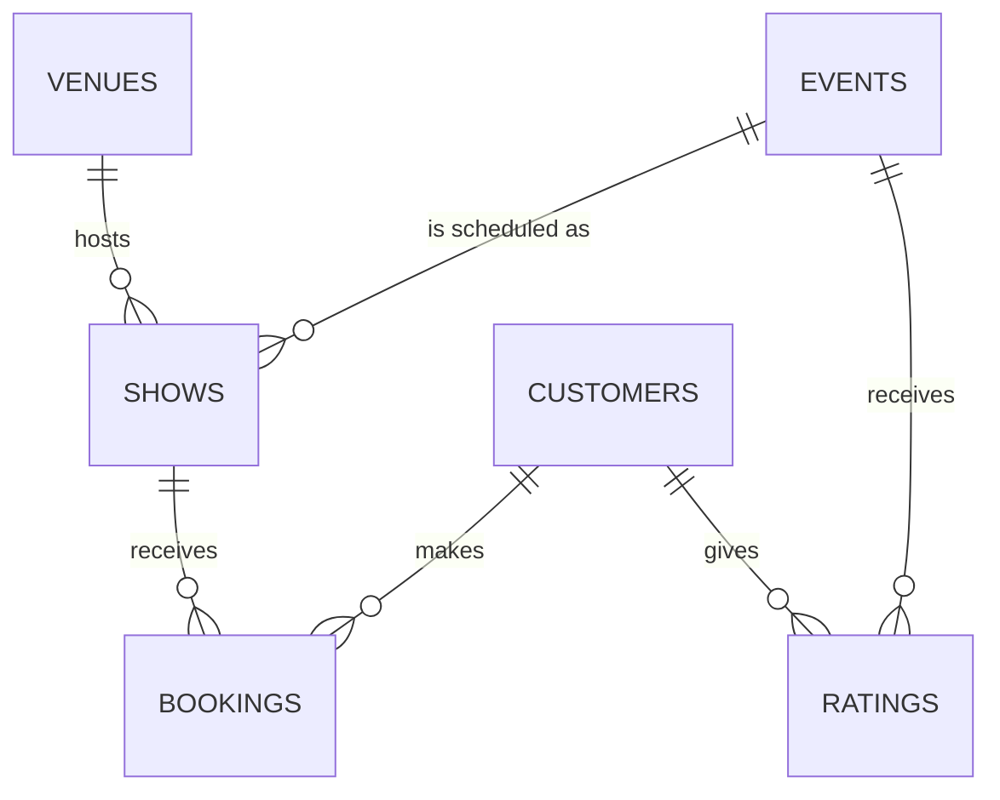

# 🎟️ BookMyShow Booking Analytics: SQL Business Analysis

> **PostgreSQL | SQL | Business Analysis | Stakeholder Recommendations
> 6 tables · 129,841 bookings · 3,210 shows · 54 venues · 20 business questions answered in SQL

---

## 📌 Table of Contents
1. [Project Overview](#-project-overview)
2. [Business Problem](#-business-problem)
3. [Expected Solution](#-expected-solution)
4. [Dataset](#-dataset)
5. [Data Model](#-data-model)
6. [Data Validation and Quality Checks](#-data-validation-and-quality-checks)
7. [Headline KPIs](#-headline-kpis)
8. [The 20 Business Questions and Answers](#-the-20-business-questions-and-answers)
9. [Key Insights](#-key-insights)
10. [Recommendations for Stakeholders](#-recommendations-for-stakeholders)
11. [Conclusion](#-conclusion)
12. [Repository Structure](#-repository-structure)
13. [How to Run](#-how-to-run)

---

## 📖 Project Overview

An online ticketing platform sells tickets across **five categories** (Movies, Plays, Sports, Events, Activities) in **10 Indian cities**. Leadership needs to know **where revenue really comes from, which customers and venues drive it, and where the business is leaving money on the table.**

This project builds a relational database in **PostgreSQL** and answers **20 business questions** covering revenue, demand, customers, venues, payments and booking behaviour. Every figure in this document comes from the SQL in [`sql/`](sql/) and was run against the data in [`data/`](data/).

## ❗ Business Problem

The business sells very different products (a ₹180 cinema ticket and a ₹5,000+ concert ticket) through the same platform, and has limited visibility into:

- Which **categories, cities and venues** generate real revenue, as opposed to just volume
- Whether **seat inventory** is being used well (empty stadiums vs. overfull cinema shows)
- Who the **customers** are, how loyal they are, and whether **membership** changes behaviour
- When customers **book** and when demand peaks
- How **clean and trustworthy** the operational data is

## ✅ Expected Solution

1. Load and validate six operational tables in PostgreSQL.
2. Answer 20 business questions with SQL (joins, CTEs, window functions, `DISTINCT ON`, conditional aggregation).
3. Convert the results into **insights and prioritised recommendations** a business stakeholder can act on.
4. Flag **data-quality issues** found along the way.

---

## 🗂️ Dataset

| Table | Rows | Description |
|---|---:|---|
| `venues` | 54 | Venue name, type (Cinema, Auditorium, Convention Centre, Stadium/Ground), city, area, capacity, screens/halls |
| `events` | 57 | Title, category, language, genre, duration, release/start date, critic rating |
| `customers` | 25,000 | Age, gender, city, signup date, membership tier, preferred category |
| `shows` | 3,210 | A scheduled show of an event at a venue: date, time, base price, capacity |
| `bookings` | 129,841 | Customer booking: date-time, seats, amount, payment mode, status (Booked / Cancelled) |
| `ratings` | 35,861 | Customer ratings (1 to 5) and review date per event |

> **Data source note:** *(Edit this line before publishing: state honestly where the data came from, for example "synthetic dataset provided as part of a SQL practice project".)*

## 🧩 Data Model

---

## 🔍 Data Validation and Quality Checks

Checks were run before any analysis. Findings are disclosed, not hidden, because they affect how far the numbers can be trusted.

| Check | Result | How it was handled |
|---|---|---|
| Missing critic ratings | **7 of 57** events have `NULL` rating | Excluded from rating rankings (Q1) |
| Missing language | Sports (and 2 Events) have no language | Shown as a blank group in Q14 |
| Unknown payment mode | **319** bookings (**287** of them successful) | Kept and reported as `Unknown` in Q9 |
| Duplicate venue names | 3 names appear under two venue IDs (Cinepolis Thane, Noida Convention Hall, Hyderabad Trade Centre) | Analysis uses `venue_id`, never the name alone |
| **Overbooked shows** | **336 of 3,210 shows (10.5%)** have more seats booked than show capacity. All are Cinema shows, with the worst at 232.5% | Reported as a finding in Q18 and in the recommendations |
| Cancelled bookings | 10,915 of 129,841 (**8.41%**) | Revenue questions count `Booked` only |

---

## 📊 Headline KPIs

*(Successful bookings only, unless stated.)*

| KPI | Value |
|---|---:|
| Successful bookings | **118,926** |
| Seats sold | **326,446** |
| Total booking revenue | **₹182.54 million** |
| Average booking value | **₹1,534.88** |
| Cancellation rate | **8.41%** (10,915 bookings, ₹16.63 million booking value) |
| Customers who booked at least once | 24,800 of 25,000 |
| Repeat-customer rate | **95.79%** |
| Average show occupancy | **50.3%** (of show capacity) |

---

## 🧠 The 20 Business Questions and Answers

Full queries are in [`sql/`](sql/). Currency is shown in ₹ and revenue counts only `Booked` status unless noted.

### Revenue and Demand

**Q1. Top 10 events by critic rating**

| Event | Category | Critic rating |
|---|---|---:|
| Diljit Dosanjh: Dil-Luminati Tour | Events | 4.9 |
| Maharaja | Movies | 4.9 |
| Sky Force | Movies | 4.8 |
| Escape Room Challenge | Activities | 4.7 |
| Jaat | Movies | 4.7 |
| IPL: Mumbai Indians vs CSK | Sports | 4.5 |
| Gustakh Ishq | Plays | 4.5 |
| Amaran | Movies | 4.5 |
| Bombay Talkies Live | Plays | 4.5 |
| Stree 2 | Movies | 4.4 |

*Answer:* Quality is spread across all five categories, and the best-rated title is a live event, not a film.

**Q2. Most popular categories (bookings)**

| Category | Bookings |
|---|---:|
| Movies | 80,332 |
| Activities | 11,763 |
| Events | 10,632 |
| Sports | 10,035 |
| Plays | 6,164 |

*Answer:* Movies account for **67.5%** of all bookings.

**Q11. Revenue by category**

| Category | Bookings | Revenue (₹) | Revenue share |
|---|---:|---:|---:|
| Events | 10,632 | 60,816,975 | **33.3%** |
| Movies | 80,332 | 57,207,335 | 31.3% |
| Sports | 10,035 | 35,265,485 | 19.3% |
| Activities | 11,763 | 22,176,050 | 12.1% |
| Plays | 6,164 | 7,071,595 | 3.9% |

*Answer:* **Events earn the most revenue from only 8.9% of bookings.** Movies bring volume, not the most money.

**Q17. Average booking value by category**

| Category | Avg booking value (₹) |
|---|---:|
| Events | 5,720.18 |
| Sports | 3,514.25 |
| Activities | 1,885.24 |
| Plays | 1,147.24 |
| Movies | 712.14 |

*Answer:* An Events booking is worth about **8x** a Movies booking.

**Q3. Top 5 cities by revenue (venue city)**

| City | Revenue (₹) |
|---|---:|
| Delhi-NCR | 34,752,039 |
| Mumbai | 25,883,218 |
| Hyderabad | 21,576,480 |
| Kolkata | 20,322,754 |
| Bengaluru | 19,963,335 |

*Answer:* Delhi-NCR leads with **19.0%** of revenue; the top five cities together deliver about **67%**. Mumbai has the most bookings (23,804) but is second in revenue, so its mix is more volume than value.

**Q4. Monthly booking trend (24 months, Dec 2023 to Nov 2025)**

Selected months (full 24-row output in `results/q04.txt`):

| Month | Bookings | Revenue (₹) |
|---|---:|---:|
| 2024-01 | 5,522 | **21,713,953** (peak revenue) |
| 2024-02 | 12,202 | 12,596,158 |
| 2024-05 | 1,324 | 884,255 (low) |
| 2025-07 | **13,924** (peak bookings) | 11,275,094 |
| 2025-10 | 746 | 869,380 (low) |

*Answer:* Demand is **highly seasonal and spiky**: monthly bookings swing from under 1,000 to nearly 14,000. Peaks follow major releases and events.

**Q13. Busiest booking days**

| Date | Bookings | Seats | Revenue (₹) |
|---|---:|---:|---:|
| 2025-07-03 | 607 | 1,689 | 461,410 |
| 2025-07-06 | 606 | 1,690 | 453,462 |
| 2025-07-08 | 596 | 1,633 | 428,674 |
| 2025-07-05 | 587 | 1,601 | 439,035 |
| 2025-07-07 | 586 | 1,616 | 429,588 |

*Answer:* The busiest days cluster in early July 2025, around ~600 bookings a day.

### Events, Shows and Venues

**Q8. Top 10 events by tickets sold**

| Event | Category | Tickets |
|---|---|---:|
| Pushpa 2 | Movies | 21,523 |
| Sikandar | Movies | 19,410 |
| Vettaiyan | Movies | 18,229 |
| Indian 2 | Movies | 17,340 |
| Devara | Movies | 16,354 |
| Sky Force | Movies | 13,095 |
| The Greatest of All Time | Movies | 12,869 |
| Jaat | Movies | 11,579 |
| Retro | Movies | 11,092 |
| Good Bad Ugly | Movies | 10,892 |

*Answer:* Volume leaders are all films. Note that **Sikandar has no critic rating** yet is the second-best seller, so rating alone does not predict demand.

**Q7. Show-wise performance (3,210 shows; top 5)**

| Event | Venue | Date | Bookings | Seats | Revenue (₹) |
|---|---|---|---:|---:|---:|
| Diljit Dosanjh: Dil-Luminati Tour | Ahmedabad Trade Centre | 2025-01-24 | 74 | 196 | 1,075,250 |
| Sunburn Festival | Ahmedabad Trade Centre | 2025-11-28 | 70 | 191 | 1,007,500 |
| Arijit Singh Live in Concert | Grand Ballroom Park Street | 2024-03-04 | 61 | 181 | 1,001,750 |
| AR Rahman Symphony Night | Grand Ballroom Koregaon Park | 2025-09-12 | 61 | 172 | 937,250 |
| NH7 Weekender | Grand Ballroom Koregaon Park | 2024-01-20 | 65 | 169 | 935,750 |

*Answer:* The top-earning shows are all concerts and festivals at convention venues, each earning about ₹1 million from fewer than 200 seats.

**Q6. Top venues by revenue (top 5 of 54)**

| Venue | City | Bookings | Revenue (₹) |
|---|---|---:|---:|
| Grand Ballroom Koregaon Park | Pune | 1,617 | 9,111,625 |
| Hyderabad Trade Centre (id 37) | Hyderabad | 1,181 | 8,538,935 |
| Grand Ballroom Park Street | Kolkata | 1,450 | 8,280,815 |
| Ahmedabad Sports Complex | Ahmedabad | 2,027 | 7,617,515 |
| Grand Ballroom Saket | Delhi-NCR | 1,204 | 6,671,250 |

*Answer:* The five biggest earners are convention centres and a sports complex. Not one is a cinema, even though cinemas carry two-thirds of bookings.

**Q15. Revenue by venue type**

| Venue type | Bookings | Seats | Revenue (₹) |
|---|---:|---:|---:|
| Convention Centre | 10,632 | 29,252 | 60,816,975 |
| Cinema | 80,332 | 220,470 | 57,207,335 |
| Stadium/Ground | 10,035 | 27,521 | 35,265,485 |
| Auditorium | 17,927 | 49,203 | 29,247,645 |

**Q18. Highest show occupancy (top 10)**

| Event | Venue | Date | Capacity | Seats booked | Occupancy |
|---|---|---|---:|---:|---:|
| Kalki 2898 AD | PVR Adyar | 2024-06-11 | 80 | 186 | **232.5%** |
| Sky Force | INOX Maninagar | 2025-06-04 | 85 | 195 | 229.4% |
| The Greatest of All Time | INOX Maninagar | 2025-07-11 | 86 | 197 | 229.1% |
| Pushpa 2 | INOX Maninagar | 2024-02-22 | 110 | 248 | 225.5% |
| Sky Force | INOX Maninagar | 2025-06-01 | 87 | 196 | 225.3% |
| Singham Again | INOX Koregaon Park | 2025-08-17 | 87 | 188 | 216.1% |
| Sky Force | Miraj Cinemas Howrah | 2025-06-01 | 87 | 175 | 201.2% |
| Pushpa 2 | INOX Maninagar | 2024-03-03 | 111 | 222 | 200.0% |
| Kanguva | PVR Hinjewadi | 2024-07-15 | 88 | 173 | 196.6% |
| Pushpa 2 | INOX Maninagar | 2024-03-03 | 113 | 221 | 195.6% |

*Answer:* **No real show can be above 100% full.** These rows are an **inventory-control or data-integrity problem**: 336 cinema shows (14.7% of cinema shows) sold more seats than their capacity. Average occupancy by venue type is **Cinema 65.6%, Auditorium 19.1%, Convention Centre 13.5%, Stadium/Ground 0.7%**.

### Customers

**Q5. Customers by membership tier**

| Tier | Customers | Share |
|---|---:|---:|
| Non-Member | 12,511 | 50.0% |
| Platinum | 4,206 | 16.8% |
| Gold | 4,156 | 16.6% |
| Silver | 4,127 | 16.5% |

**Q12. Booking activity by age group**

| Age group | Bookings | Seats | Revenue (₹) | Revenue share |
|---|---:|---:|---:|---:|
| 46+ | 47,261 | 130,125 | 73,496,237 | **40.3%** |
| 36-45 | 24,000 | 66,027 | 37,210,673 | 20.4% |
| 26-35 | 23,880 | 65,105 | 35,789,868 | 19.6% |
| 18-25 | 19,090 | 52,225 | 28,662,010 | 15.7% |
| Under 18 | 4,695 | 12,964 | 7,378,653 | 4.0% |

*Answer:* **Customers aged 46+ are the single largest revenue segment (40%).**

**Q10. Repeat customers:** 23,755 customers made more than one successful booking. The most active made 16 bookings each (for example customer IDs 24095, 798, 8621, 16623 and 23782).

**Q19. One-time vs repeat customers**

| Customer type | Customers | Share |
|---|---:|---:|
| Repeat | 23,755 | **95.79%** |
| One-time | 1,045 | 4.21% |

*Answer:* Almost every customer who books comes back. Loyalty is not the problem; **getting each customer to spend more per visit is the opportunity**.

**Q16. Latest successful booking per customer:** one row for each of the 24,800 customers who have booked, showing their most recent booking (`DISTINCT ON`). This is the base list for win-back and re-engagement campaigns.

### Payments and Behaviour

**Q9. Payment mode analysis (successful bookings)**

| Payment mode | Bookings | Revenue (₹) | Revenue share |
|---|---:|---:|---:|
| UPI | 51,259 | 79,278,980 | **43.4%** |
| Wallet | 16,753 | 25,896,683 | 14.2% |
| Debit Card | 16,816 | 25,791,424 | 14.1% |
| Net Banking | 16,929 | 25,727,251 | 14.1% |
| Credit Card | 16,882 | 25,324,285 | 13.9% |
| Unknown | 287 | 518,817 | 0.3% |

**Q14. Bookings by event language**

| Language | Bookings | Tickets |
|---|---:|---:|
| Hindi | 32,620 | 89,265 |
| English | 31,291 | 85,974 |
| Kannada | 15,912 | 43,597 |
| *(no language: Sports and 2 Events)* | 12,591 | 34,572 |
| Tamil | 11,922 | 32,862 |
| Malayalam | 7,846 | 21,523 |
| Telugu | 6,744 | 18,653 |

**Q20. Booking lead time (days between booking and show)**

| Lead time | Bookings | Seats | Revenue (₹) | Share of bookings |
|---|---:|---:|---:|---:|
| Same day | 228 | 616 | 390,441 | 0.2% |
| 1-3 days | 18,076 | 49,341 | 27,877,660 | 15.2% |
| 4-7 days | 23,199 | 64,169 | 36,293,819 | 19.5% |
| 8-15 days | 44,647 | 122,329 | 68,067,713 | **37.5%** |
| More than 15 days | 32,776 | 89,991 | 49,907,808 | 27.6% |

*Answer:* **65% of bookings are made more than a week ahead.** Customers plan; very few buy last-minute.

> **Technical note on Q20:** the original `ORDER BY` repeated a nested `CASE` and PostgreSQL rejected it (`column "s.show_date" must appear in the GROUP BY clause`). The fixed query sorts with `ORDER BY MIN(CASE ... END)` using the same bucket logic. The corrected file is `sql/q20_fixed.sql`.

---

## 💡 Key Insights

1. **Movies bring traffic, Events bring money.** Movies are 67.5% of bookings but 31.3% of revenue; Events are 8.9% of bookings but 33.3% of revenue, with an average booking worth 8x higher.
2. **Revenue is concentrated.** Five cities deliver about two-thirds of revenue; Delhi-NCR alone is 19%.
3. **Premium venues beat cinemas on revenue.** The top 5 venues are all convention or sports venues, and the top 5 shows are all concerts and festivals.
4. **Seat inventory is badly balanced.** Cinemas average 65.6% occupancy and 336 shows are *over* capacity, while auditoriums (19.1%), convention centres (13.5%) and stadiums (0.7%) are mostly empty.
5. **Customers are loyal but spend little per visit.** 95.8% are repeat customers, yet the average Movies booking is only ₹712.
6. **Membership is not changing behaviour.** Half of customers are non-members, and average booking value is about the same across tiers (Gold ₹1,491, Silver ₹1,525, Platinum ₹1,526, Non-Member ₹1,555). Non-members even spend slightly more.
7. **Customers aged 46+ drive 40% of revenue.** Under-18s are only 4%.
8. **UPI dominates payments** (43% of bookings and revenue), and there is no meaningful gap between other modes.
9. **Customers plan ahead.** About 65% of bookings happen more than 7 days before the show, and same-day bookings are only 0.2%.
10. **Cancellations are steady at about 8.4% in every category** (8.1% to 8.7%), so they are a platform-wide pattern rather than a category problem.
11. **Demand is very seasonal**, from under 1,000 to nearly 14,000 bookings a month.

---

## 🎯 Recommendations for Stakeholders

| # | Priority | Recommendation | Evidence | Expected business impact |
|---|---|---|---|---|
| 1 | 🔴 High | **Fix overbooking now.** Enforce a hard seat-inventory cap at checkout, and audit the 336 over-capacity cinema shows. | 336 shows (10.5%) exceed capacity, up to 232.5% | Removes customer-experience and refund risk; protects brand trust |
| 2 | 🔴 High | **Grow Events and Sports.** Add more concerts, festivals and marquee matches, especially in Delhi-NCR, Mumbai and Hyderabad. | Events: 33.3% of revenue from 8.9% of bookings | Highest revenue per booking (₹5,720 vs ₹712 for Movies) |
| 3 | 🔴 High | **Raise basket value on Movies.** Bundle snacks, premium seats and group packs; use dynamic pricing at peak demand. | 80,332 bookings but only ₹712 average | Even a small lift per booking is large at this volume |
| 4 | 🟠 Medium | **Fill empty inventory.** Run off-peak discounts and targeted promotions for auditoriums, convention centres and stadiums. | Occupancy 19.1%, 13.5% and 0.7% | Turns idle capacity into revenue |
| 5 | 🟠 Medium | **Redesign the membership programme.** Give Silver, Gold and Platinum real, visible benefits such as early access, priority seats and cashback. | Half of customers are non-members; tiers do not spend more | Move non-members into paid tiers and lift spend per tier |
| 6 | 🟠 Medium | **Target the 46+ segment.** Build offers around plays, family events and morning shows; test targeted campaigns for 18-35 to grow them. | 46+ is 40.3% of revenue | Protects the biggest segment and widens the base |
| 7 | 🟠 Medium | **Use the booking window.** Run early-bird pricing at 8-15 days and "last seats" urgency messaging at 1-3 days. | 65% book more than 7 days ahead | Smoother demand and better pricing power |
| 8 | 🟡 Lower | **Plan for seasonality.** Schedule releases and campaigns against the monthly peaks and troughs. | 649 to 13,924 bookings per month | Better staffing, marketing timing and inventory |
| 9 | 🟡 Lower | **Reduce cancellations.** Add reminders, easy rescheduling and partial-credit refunds. | 8.41% cancelled (₹16.63M booking value) | Recovers part of ₹16.6M of lost booking value |
| 10 | 🟡 Lower | **Strengthen payments.** Keep UPI frictionless, offer UPI/wallet cashback, and make payment mode mandatory in the data. | UPI is 43% of bookings; 319 bookings have unknown mode | Higher conversion and cleaner data |
| 11 | 🟡 Lower | **Improve data quality.** Enforce non-null critic rating and language, unique venue names, and rating-to-booking linkage. | 7 null ratings, 3 duplicate venue names, 319 unknown payments | Reliable reporting and decisions |

---

## ✅ Conclusion

The platform's strength is a **huge, loyal customer base** (95.8% repeat customers) and strong Movies traffic. Its opportunity is in **value, not volume**: Events and Sports earn far more per booking, most non-cinema inventory sits unused, and membership is not yet rewarding loyal customers.

The most urgent action is a **seat-inventory control fix**, because over 10% of shows sold more seats than they have. After that, the three highest-return moves are **growing Events and Sports**, **raising Movies basket value**, and **filling idle venue capacity**.

> **Limitations:** results describe the provided dataset (Dec 2023 to Nov 2025) and not the real platform. Revenue is booking value of successful bookings and does not account for refunds, taxes or platform fees. Customer-level recommendations should be validated with an A/B test before a full rollout.

---
## 👤 Author
**Dharshanram S**: Data / MIS Analyst · [LinkedIn](https://www.linkedin.com/in/dharshanram-s-8b856b341)

